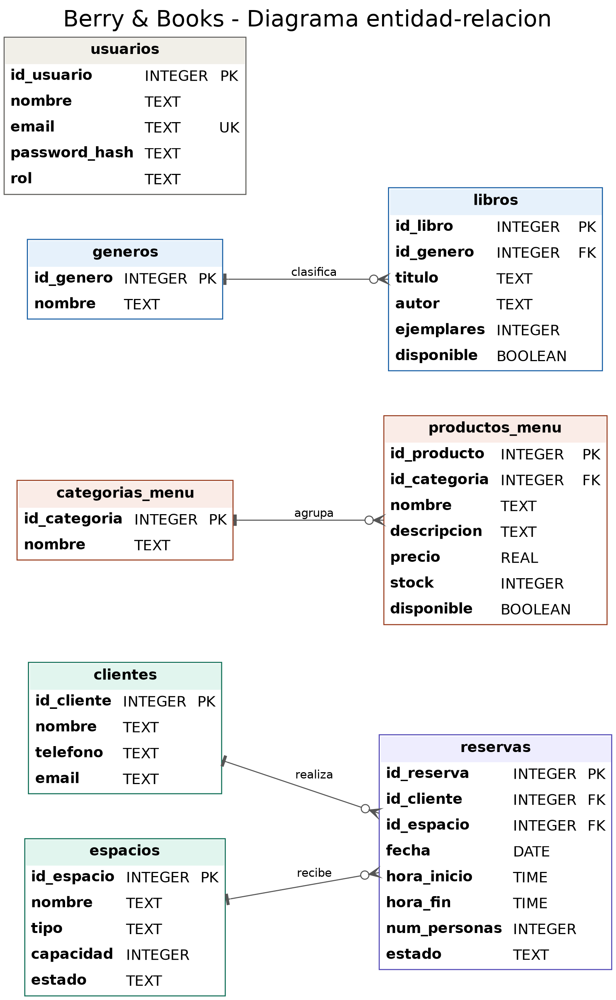

# Berry & Books: Catálogo y Reserva de un Cozy Book Café

## 1. Análisis y planteamiento

### Nombre del proyecto
**Berry & Books**: Catálogo y Reserva de un Cozy Book Café.

### Descripción del problema
Los cafés temáticos de lectura suelen administrar sus reservas por llamadas, mensajes o cuadernos. Esto provoca:

- Dos clientes pueden reservar la misma mesa o zona a la misma hora, porque nadie detecta el solapamiento.
- El personal no sabe en tiempo real qué espacios están libres u ocupados.
- El catálogo de libros y el menú de repostería no están actualizados ni al alcance de los clientes antes de visitar el local.
- El control del inventario (libros y productos) se lleva de forma manual y desordenada.

### Objetivo general
Desarrollar una aplicación web que permita a los clientes consultar el catálogo de libros y el menú, y reservar espacios de lectura, y que permita al personal administrar espacios, inventario y reservas desde un panel privado, evitando conflictos de horarios.

### Objetivos específicos
1. Diseñar una base de datos relacional en SQLite que almacene libros, productos del menú, espacios y reservas.
2. Desarrollar una API con FastAPI que ofrezca operaciones CRUD y valide que un espacio no se reserve dos veces en el mismo rango de fecha y hora.
3. Construir una interfaz web clara que consuma la API y permita a clientes y personal usar el sistema.
4. Publicar el proyecto en GitHub y Vercel, con documentación completa.

### Principales funcionalidades
**Para el cliente (área pública):**
- Explorar el catálogo de libros disponibles para leer en el local.
- Ver el menú de repostería con su disponibilidad.
- Consultar los espacios (mesas y zonas de lectura) y su capacidad.
- Crear una reserva indicando espacio, fecha, hora de inicio y fin, y sus datos de contacto.

**Para el personal (panel de administración con inicio de sesión):**
- Gestionar libros, géneros, menú y categorías: agregar, consultar, editar y eliminar.
- Gestionar espacios: agregar, editar, eliminar y cambiar su estado (disponible, mantenimiento).
- Gestionar clientes y reservas: consultar, modificar, confirmar y cancelar.

**Regla de negocio principal:** el sistema rechaza cualquier reserva cuyo horario se traslape con otra ya existente en el mismo espacio (las reservas canceladas no cuentan).

### Usuarios del sistema
| Usuario | Descripción | Qué hace |
|---|---|---|
| Cliente | Persona que visita o desea visitar el café | Explora catálogo y menú, reserva espacios |
| Administrador / personal | Encargado del café | Gestiona inventario, espacios y reservas |

## 2. Diseño de la base de datos

### Diagrama entidad-relación

También disponible en `diagrama_er.pdf`, `diagrama_er.svg` y como código Mermaid en `er.mmd`.

### Descripción de las principales tablas

**clientes**: personas que realizan reservas.

| Campo | Tipo | Llave | Descripción |
|---|---|---|---|
| id_cliente | INTEGER | PK | Identificador único |
| nombre | TEXT | | Nombre completo |
| telefono | TEXT | | Teléfono de contacto |
| email | TEXT | | Correo electrónico |

**espacios**: mesas y zonas de lectura reservables.

| Campo | Tipo | Llave | Descripción |
|---|---|---|---|
| id_espacio | INTEGER | PK | Identificador único |
| nombre | TEXT | | Nombre del espacio (único) |
| tipo | TEXT | | mesa, zona de lectura o sala privada |
| capacidad | INTEGER | | Máximo de personas |
| estado | TEXT | | disponible o mantenimiento |

**reservas**: reserva de un espacio por un cliente en una fecha y rango de horas.

| Campo | Tipo | Llave | Descripción |
|---|---|---|---|
| id_reserva | INTEGER | PK | Identificador único |
| id_cliente | INTEGER | FK | Cliente que reserva (clientes) |
| id_espacio | INTEGER | FK | Espacio reservado (espacios) |
| fecha | TEXT | | Fecha AAAA-MM-DD |
| hora_inicio | TEXT | | Hora HH:MM |
| hora_fin | TEXT | | Hora HH:MM (posterior a la de inicio) |
| num_personas | INTEGER | | Cantidad de personas |
| estado | TEXT | | pendiente, confirmada o cancelada |

**categorias_menu**: tipos de producto del menú.

| Campo | Tipo | Llave | Descripción |
|---|---|---|---|
| id_categoria | INTEGER | PK | Identificador único |
| nombre | TEXT | | Nombre de la categoría (único) |

**productos_menu**: productos de repostería con precio y existencias.

| Campo | Tipo | Llave | Descripción |
|---|---|---|---|
| id_producto | INTEGER | PK | Identificador único |
| id_categoria | INTEGER | FK | Categoría (categorias_menu) |
| nombre | TEXT | | Nombre del producto |
| descripcion | TEXT | | Descripción breve |
| precio | REAL | | Precio de venta |
| stock | INTEGER | | Unidades disponibles |
| disponible | INTEGER | | 1 = se muestra en el menú, 0 = oculto |

**generos**: géneros literarios.

| Campo | Tipo | Llave | Descripción |
|---|---|---|---|
| id_genero | INTEGER | PK | Identificador único |
| nombre | TEXT | | Nombre del género (único) |

**libros**: catálogo de libros disponibles para leer en el local.

| Campo | Tipo | Llave | Descripción |
|---|---|---|---|
| id_libro | INTEGER | PK | Identificador único |
| id_genero | INTEGER | FK | Género (generos) |
| titulo | TEXT | | Título |
| autor | TEXT | | Autor |
| ejemplares | INTEGER | | Ejemplares en el local |
| disponible | INTEGER | | 1 = disponible, 0 = no disponible |

**usuarios**: personal administrador con acceso al panel.

| Campo | Tipo | Llave | Descripción |
|---|---|---|---|
| id_usuario | INTEGER | PK | Identificador único |
| nombre | TEXT | | Nombre del administrador |
| email | TEXT | UK | Correo único para iniciar sesión |
| password_hash | TEXT | | Contraseña cifrada (nunca en texto plano) |
| rol | TEXT | | Rol dentro del sistema |

### Llaves primarias
`id_cliente`, `id_espacio`, `id_reserva`, `id_categoria`, `id_producto`, `id_genero`, `id_libro` e `id_usuario`: enteros autoincrementales, uno por tabla.

### Llaves foráneas
| Tabla | Llave foránea | Referencia a |
|---|---|---|
| reservas | id_cliente | clientes(id_cliente) |
| reservas | id_espacio | espacios(id_espacio) |
| productos_menu | id_categoria | categorias_menu(id_categoria) |
| libros | id_genero | generos(id_genero) |

Todas usan `ON DELETE RESTRICT`: no se puede borrar un registro que otros registros usan.

### Relaciones entre las tablas
| Relación | Tipo | Explicación |
|---|---|---|
| clientes - reservas | Uno a muchos | Un cliente puede hacer muchas reservas; cada reserva es de un solo cliente |
| espacios - reservas | Uno a muchos | Un espacio tiene muchas reservas en distintos horarios; cada reserva es de un solo espacio |
| categorias_menu - productos_menu | Uno a muchos | Una categoría agrupa muchos productos |
| generos - libros | Uno a muchos | Un género clasifica muchos libros |

La tabla `usuarios` no se relaciona con otras: solo controla el acceso al panel de administración.

### Regla de negocio principal
Para un mismo espacio y fecha no pueden existir dos reservas activas con rangos de hora traslapados. El backend (FastAPI) valida la regla dentro de una transacción con bloqueo (`BEGIN IMMEDIATE`), de modo que dos solicitudes simultáneas no puedan reservar el mismo horario.
